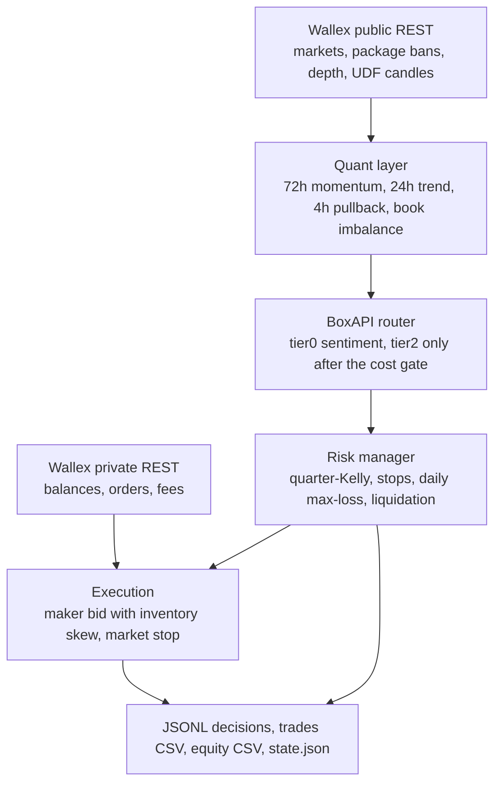

# Strategy

Long-only TMN spot. The bot buys an uptrend that has pulled back, holds about 24 hours, and sells back to TMN. It does not scalp. Round-trip fees on this account are larger than a typical 15-minute move, so the clock is hourly and the stop is wide enough that noise does not tag it.

## Architecture



Backtest, shadow, and live call `evaluate_symbol`, `TradingAgent.decide`, and `RiskManager.plan`. Only the fill model changes.

## Buy

A symbol is a candidate only when every gate passes on the last closed hourly bar:

- 72-hour return ≥ 0. This is the slow time-series momentum filter (Moskowitz, Ooi and Pedersen, 2012). The floor is zero. It was not fitted.
- EMA(8) > EMA(24) and close > EMA(24).
- 24-hour return ≥ +1%.
- 4-hour return between −2.5% and −0.4% (a pullback, not a crash).
- Hourly ATR ≤ 3% of price.
- Spread ≤ 22 bps. Missing spread blocks the name.
- Best-level order-book imbalance is not worse than −0.55 when a book is available. Imbalance is `(bid qty − ask qty) / (bid qty + ask qty)` at the touch, from `GET /v2/depth/all` (Cont, Kukanov and Stoikov, 2014). The backtest has no historical book, so this gate is live and shadow only.
- Last closed 15-minute return ≥ −0.4% in shadow and live. Backtest passes this as unknown.
- Researched gross edge of 0.9% is greater than 1.2 × the execution cost.

Execution cost, in the sense of Almgren and Chriss (2000), is entry fee + exit fee + half the spread + 3 bps of slippage. With maker entry and maker exit that is 0.25% + 0.25% + half-spread + 0.03%. The 1.2 multiple is a fixed buffer on top of that sum, not a second spread. The 0.9% figure is a prior, not a number the model is allowed to inflate.

The quant score is `0.40 × trend + 0.30 × pullback depth + 0.20 × spread + 0.10 × book`. The quant layer is the only trade trigger. Size is quarter-Kelly from a prior win probability of 0.55 and a payoff of 1.0, which is 2.5% of equity, and it cannot exceed the 12% per-trade cap.

## Liquidity

Each cycle, for every symbol, the bot records four numbers and their z-scores against the recent window (24 points, at least 18 before a z-score is trusted):

- Depth: quote notional sitting within 0.5% and within 1% of mid, from `GET /v2/depth/all`. The 1% figure is the one that gates and sizes.
- Spread: the touch, in basis points.
- Traded volume: the last closed hour's quote volume (base size times close). The z-score is on the log, so a typical quiet hour is not a shock.
- The change in each series, also as a z-score. Depth and volume are scored in logs. The standard deviation has a floor (0.20 log points for the level, 0.15 for the change, 1 bp for the spread) so a smooth hour is not called a shock.

An entry is skipped when depth inside 1% is under 1,000,000 TMN, when depth or log-volume is two standard deviations below its recent history, or when the spread is two standard deviations above it. A missing book does not block. The backtest has no historical depth, so only the volume score can veto a historical bar. The order, after quarter-Kelly, must also be at most 10% of the 1% depth. If the cut falls under the 50,000 TMN minimum, the entry is refused.

Size uses the worst of those z-scores. A rising book and rising volume keep the full post-Kelly size. A deteriorating one scales it down, to half at the block threshold. The scale never increases size. It is applied after quarter-Kelly, because the 12% quant fraction sits above the 2.5% Kelly cap and a cut there would not change the order.

Stops, the kill switch, and the aggressive liquidation window (from 23:20) still trade through a thin book. A time stop, and the passive flatten that starts at 22:50, wait while the book is thin or the spread has just blown out. The time stop gives that wait at most 6 extra hours. The passive flatten stops waiting when the aggressive window opens. The metrics are on every feature row in `decisions.jsonl` (`depth_100_tmn`, `depth_50_tmn`, the z-scores, `liquidity_scale`, `exit_ready`).

## What the model does

BoxAPI `POST /chat/completions` goes through one router. The quant layer is still the only trigger. The router picks the model after that, and it makes at most one decision call per cycle:

| Tier | When | Model | Effort |
| --- | --- | --- | --- |
| routine (tier0) | Flat cycle, headline scoring | `gpt-6-luna` (or `gpt-5.4-mini`) | low |
| signal (tier1) | A position is open and no new candidate cleared the cost gate | `gpt-6-luna` | medium |
| trade (tier2) | A quant candidate exists, so the cost gate already passed | `gpt-6-sol` | high |

Trade decisions are open, close, or size. Every candidate and open position goes in one compact JSON prompt. The reply is one JSON object: regime, optional `veto_all`, and decisions with action, symbol, size fraction, confidence, and rationale. Headline scoring is a separate short call, cached for 15 minutes, and it runs on a flat cycle so it does not sit in front of a trade. A failed score leaves the lexicon number in place.

This is a meta-label, not a signal (López de Prado, 2018): the primary model proposes the bet, and the secondary model only accepts, rejects, or shrinks it. If the model abstains, the top quant candidate is still eligible. `regime: hostile` or `veto_all: true` blocks every new entry. An explicit BUY confirms that symbol only and does not fall through to a different name. A per-symbol `veto: true` drops that name.

The model may also close a held name when close is below the slow EMA and the 24-hour return has turned negative. It may not invent a symbol, raise size, loosen a stop, or override the kill switch. A BUY confirmation with confidence below 0.55 is dropped. `temperature` and `response_format` are omitted. `reasoning_effort` is sent. If the model answers HTTP 400, the same request is retried once without that field. `LLM_MODEL`, when set, pins every tier to that one model.

Budget, because the whole competition is $3:

- hard stop at `max_spend_usd: 2.50` and `max_spend_usd_per_day: 1.25` (Tehran day), using `usage.cost` when BoxAPI sends it,
- at $2.00 total or $1.00 today the router steps down one tier; inside $0.20 of either cap it uses the routine tier,
- `max_llm_calls_per_hour: 8`, `max_llm_calls_total: 160`, at least 1 second between calls, and exponential backoff on HTTP 429 and 5xx,
- assumed prices $0.50 / million input tokens and $2.00 / million output tokens, or $0.08 if the response has no usage,
- model, tier, token counts, and USD are stored on the decision (`agent.usage` and `llm_calls`) and in `data/llm_usage.json`,
- timeout, HTTP error, bad JSON, a missing key, or a cap all fall back to the deterministic ranking. The source field is `llm`, `llm_cache`, or `fallback`.

Backtest sets `use_llm=False`. A key in the environment cannot spend money during a historical run.

Wallex MCP (`wallex_basic_candle_history`) is an optional note in the prompt. Two failures disable it. The loop does not depend on it. Private user WebSocket needs a cookie JWT, so order status is polled with REST.

## Sell

- Disaster stop at −4.5% from the fill. MARKET when the symbol allows market orders, otherwise an aggressive limit through the bid. Extra 5 bps of slippage is charged in the backtest. A stop starts a 6-hour cooldown on that symbol.
- Trailing stop arms after +2.5% and sells 1.2% off the peak.
- Time exit after 24 hours rests as a maker offer. The offer is the ask, pulled toward the mid by the inventory skew, and it never crosses the bid. The backtest gives that quote one bar: a fill if the next high reaches it, otherwise a taker at the next close.
- No fixed take-profit. On this fee tier a tight target converted the 24-hour drift into a loss.
- The model may request an early close under the rule above. The risk layer still checks that a position exists.

## Capital and risk

The risk manager runs after the model and can only shrink a buy.

| Rule | Value |
| --- | --- |
| Per trade and per symbol | quarter-Kelly from the prior, hard-capped at 12% of equity |
| Gross exposure | 30% (never all-in) |
| Open positions | 2 |
| New entries per cycle | 1 |
| Entries per hour | 2 |
| Orders per hour | 8 |
| Minimum notional | 50,000 TMN |
| Daily max-loss kill | 1.5% below the Tehran-day starting equity. Flattens and blocks new buys. |
| Global drawdown kill | 3% from peak equity |

Either kill switch flattens and blocks new buys until the process is restarted with `--fresh` or the state file is cleared. The flag is persisted in `state.json`.

Universe at startup: config candidates ∩ not on the package-183 ban list ∩ TMN quote ∩ 24h quote volume ≥ 8 billion TMN ∩ spread ≤ 22 bps ∩ at most 6 names. The ban list is fetched from `GET /v1/prop/packages/183`. If that call fails, live and shadow exit. They do not trade a stale allow-list. SOL and BNB sit in the candidate list so the audit shows them, and the spread cap drops them when the book is wide.

## Liquidation

Deadline `2026-10-23T23:50:00+03:30`. Flat-by target `2026-10-23T23:30:00+03:30`.

- Entries stop when fewer than 8 hours remain before flat-by.
- From 22:50 Tehran, phase `passive`: no new buys, resting limits sell inventory.
- From 23:20 Tehran, phase `aggressive`: market sells (or aggressive limits if market orders are disabled). The phase stays aggressive after the deadline until the book is flat.

## Execution assumptions

Entry joins the bid. The price is the Avellaneda and Stoikov (2008) reservation shift applied to the touch: `bid × (1 − q γ σ² τ)`, with `q` the current gross exposure, `γ = 0.5`, `σ` the hourly ATR, and `τ` the 24-hour hold. A flat book does not move the quote. The order is rounded down to the tick and is not allowed to cross the ask, so it pays the maker fee. The same skew pulls a long inventory's offer toward the mid without crossing the bid.

The backtest does not assume the bid is filled. The quote rests for the next hourly bar and fills only if that bar's low trades to the limit. That is the adverse-selection case, and it is the one the fill model uses. A missed quote is cancelled rather than chased. Stops still use the low of the bar and pay the taker fee. Walk-forward folds flatten leftovers as a taker so each fold's PnL is realized.

Live and shadow read every book from `GET /v2/depth/all` once per cycle (per-symbol `/v1/depth` is only the fallback). A maker order that is not filled stays working for 10 minutes and is then cancelled. Shadow marks a paper fill only after the touch trades through the quote.

Buy fees reduce base quantity. Sell fees reduce TMN proceeds. Equity is mark-to-market in TMN.

## How to evaluate

```bash
python3 -m trader --mode backtest --config config/default.yaml
python3 -m trader --mode report --log-dir results/backtest
```

`results/backtest/report.md` reports net return, max drawdown, annualized Sharpe from the equity spacing, win rate on closed trades, fees, trade count, and how often each agent source spoke. `aggregation_check.json` compares two days of BTCTMN 1-minute bars aggregated locally with the native hourly series. Wallex returns 1-minute bars for resolution `1` and `15`, and 1-hour bars for `60`. The client aggregates anything else itself.

Shadow:

```bash
python3 -m trader --mode shadow --config config/default.yaml --duration 900 --interval 45 --fresh --out results/shadow
```

## Sentiment

Two inputs, both optional. A failed source is logged and skipped. The decision cycle still runs.

- **Fear & Greed** (alternative.me). Level 0–100 and the one-day change. In the backtest the value is the latest point whose timestamp is at least one day before the bar, so the bot does not read an index that was not published yet. Live uses the newest published point.
- **Headlines.** CoinDesk and Cointelegraph RSS, plus CryptoPanic and Reddit when those public endpoints answer. Titles are matched to the coin (`bitcoin` for BTCTMN, and the same for the other TMN names) and scored with a fixed positive/negative word list. The score is in [−1, 1]. The change is versus the previous cached score. Headlines are not in the backtest, because the feeds are not a point-in-time archive. On a flat live or shadow cycle the router may rescore the same titles with tier0 (`gpt-6-luna`, low effort), cached for 15 minutes. If that call fails or the budget is tight, the lexicon score stays.

Both the level and the change are fields on each symbol's feature payload, so the regime filter can see them. A missing field is not itself a veto.

The only hard rule that was tested is pre-specified: block a new entry when lagged Fear & Greed is at least 80 (extreme greed), on the view that a pullback in a crowded market is more likely to become a larger decline. It is kept only if the with-gate backtest beats the without-gate backtest by at least 0.05 percentage points of return, does not worsen max drawdown by more than 0.10 points, and still closes at least 8 trades. Otherwise the number stays an input and the gate stays off. The comparison is `results/backtest/sentiment_ablation.json`. Thresholds were not searched.

On the 2026-10-22 hourly window the lagged index ranged from 53 to 78. It never reached 80, so the gate bound zero times. With and without the gate the books are the same: ending equity 4,993,712 TMN, return −0.126%, max drawdown 0.436%, realized PnL −349 TMN, fees 11,736 TMN, 17 closed trades. `gate_helps` is false, and `sentiment.block_extreme_greed` stays false. The level and the daily change are still attached on every feature row (695 rows, none missing) and are passed to the regime filter. Headline scores are live-only. From this network CoinDesk and Cointelegraph RSS answer; CryptoPanic and Reddit return 403 and are skipped.

## Literature

| Piece | Source | What the bot uses |
| --- | --- | --- |
| Cost gate | Almgren and Chriss (2000), *Journal of Risk* 3(2) | Trade only when the prior edge exceeds fees + half-spread + slippage, with a fixed 1.2 buffer. |
| Book imbalance | Cont, Kukanov and Stoikov (2014), *Journal of Financial Econometrics* 12(1) | Best-bid versus best-ask quantity from `/v2/depth/all`. A strongly offered book blocks the entry. |
| Liquidity | Depth within a band of mid, plus the spread and log traded volume | Z-scores versus the recent window. A sudden thin book, a wide spread, or dried-up volume blocks the entry and cuts size. Passive liquidation waits for a book that can take the order. |
| Inventory quotes | Avellaneda and Stoikov (2008), *Quantitative Finance* 8(3) | Reservation-price skew. The arrival-intensity spread is not fitted. |
| Slow momentum | Moskowitz, Ooi and Pedersen (2012), *Journal of Financial Economics* 104(2) | 72-hour return must be non-negative before the faster pullback can arm. |
| Regime filter | López de Prado (2018), *Advances in Financial Machine Learning*, meta-labeling | The LLM vetoes or downsizes. It does not create the trade. Fear & Greed and the headline score are inputs to that veto. |
| Sentiment | alternative.me Crypto Fear & Greed; a fixed headline lexicon | Level and daily change. Extreme greed is the only gated test, and only if the ablation says it helps. |
| Sizing | Kelly (1956), *Bell System Technical Journal* 35(4); Thorp (2006) on fractional Kelly | Quarter-Kelly from a stated prior, capped by the fixed 12% fraction. |
| Overfitting check | Bailey and López de Prado (2014), *Journal of Portfolio Management* 40(5) | Deflated Sharpe with N = 6 families that were looked at before this rule was locked. Three walk-forward folds, no refit. |

N = 6 counts breakout, continuation, cross-sectional momentum, dip reversal, tight-stop pullback, and this slow-momentum pullback. It is not a grid on the equity curve below. Parameters were not searched again after the walk-forward numbers were computed.

The report's desk block is PnL after fees (mark-to-market and realized), annualized Sharpe, max drawdown, hit rate, and decision latency (median and p95 of the cycle, from the book fetch through the risk plan).

## Result recorded on 2026-10-22

`python3 -m trader --mode backtest --config config/default.yaml` on the live hourly history (695 bars, about 29 days) selected USDTTMN, BTCTMN, ETHTMN, XAUTTMN, XRPTMN, and DOGETMN. The deterministic agent ran on every bar. Maker quotes had to be touched by the next bar. Size was quarter-Kelly.

| Desk metric | Value |
| --- | --- |
| PnL after fees, mark-to-market | −6,288 TMN (−0.126%) |
| PnL after fees, realized | −349 TMN |
| Sharpe (annualized) | −1.13 |
| Max drawdown | 0.436% |
| Hit rate | 58.8% (17 closed trades) |
| Fees | 11,736 TMN |
| Deflated Sharpe probability | 0.052 (per-bar Sharpe −0.0121, hurdle 0.048 at N=6) |

Fear & Greed was attached on every bar (lagged, range 53–78). The extreme-greed gate was left off because the ablation did not change a single trade. Walk-forward, frozen parameters, fresh 5,000,000 TMN each fold: +0.136%, −0.154%, −0.153%. Fold deflated-Sharpe probabilities are 0.173, 0.000, and 0.003. The rule does not clear the Bailey and López de Prado hurdle. Parameters were not changed after seeing this. Open buys on the last bar are why mark-to-market PnL is worse than realized PnL. Candle aggregation for BTCTMN matched native hourly closes (median absolute error 0). The series used for the ablation is `results/backtest/fear_greed.json`.

A short shadow the same afternoon (`--duration 200 --interval 45`, no API key) ran five fallback cycles from 16:35 to 16:38 Asia/Tehran. No candidate cleared the gates, so there were no orders. Equity stayed 5,000,000 TMN. Median decision latency was 4.1 seconds. Fear & Greed printed 68 (Greed), up 5 from the prior published point. CoinDesk and Cointelegraph headlines were scored; CryptoPanic and Reddit returned 403 and were skipped. Later cycles reused the 15-minute headline cache. The Wallex MCP candle tool responded. Zero errors.

## Research, and what was not tuned

On roughly 29 days of hourly candles, non-overlapping holds of this setup on the liquid majors were slightly positive after 0.50–0.58% costs: on the order of +0.1% average net trade, equity well under +1% at a 15% weight, max drawdown about 2–3%. Breakouts, continuation, cross-sectional momentum, and tight stops were negative after fees. The shipped parameters are that setup. They were not grid-searched against the backtest equity curve. If the engine backtest is flat, that is the result; names are not dropped after seeing them lose.

The backtest universe uses a spread snapshot from 2026-10-22 when no live book is passed in. That is lookahead of *which names are liquid*, not of future prices. Shadow and live replace the snapshot with the current book.

## Wallex details that are still uncertain

Check these before sending real orders:

- Whether `sub-account-client-id` is required when the key already belongs to the credit sub-account. The header is sent only if `WALLEX_SUBACCOUNT_ID` is set.
- The live fee tier from `GET /v1/account/fee`. Defaults are 0.25% maker / 0.30% taker. Live replaces them per symbol when the key works.
- Whether `unavailableMarkets` changes after the plan is activated. The bot refetches it and refuses every symbol on the list. USDTTMN and BTCTMN were tradable in the 2026-10-22 fetch; ZECTMN was not. Do not trust an empty list from an older video.
- MARKET quantity is sent as base-asset size. Confirm that on a tiny order if you use a market stop.
- Some symbols report `isMarketTypeEnable: false` (DOGE and XRP did in one snapshot). Stops then become aggressive limits.
- Order rate limit is treated as 15 per 10 seconds inside the documented 20 per 10 seconds. Public reads are paced at 5 per second.
- `minNotional` on the allowed TMN markets was 50,000 TMN. The client rejects a body under the live rule.
- `tickSize` and `stepSize` are decimal counts, not increments. Prices and quantities are formatted as fixed-point strings. POST `/v1/account/orders` expects HTTP 201.
- Half-spread entry is an assumption about queue position. A real limit at the ask can still miss if the book steps away.
- No private WebSocket. Fills are observed by GET `/v1/account/orders/{clientOrderId}`.

## خلاصه فارسی

ربات فقط روی جفت‌های تومانی مجاز پلن ۱۸۳ معامله می‌کند و فهرست بازارهای ممنوع را در شروع می‌گیرد. سیگنال، پولبک در روند صعودی ساعتی است و فقط وقتی فعال می‌شود که هزینه رفت‌وبرگشت کارمزد را پوشش بدهد. عمق دفتر سفارش، اسپرد، و حجم معاملات اگر ناگهان بد شوند ورود را می‌بندند و اندازه را بعد از کلی کوچک می‌کنند؛ خروج اجباریِ آرام منتظر نقدشوندگی می‌ماند و از ۲۳:۲۰ دیگر منتظر نمی‌ماند. شاخص ترس و طمع و امتیاز اخبار به‌عنوان ورودی به فیلتر رژیم داده می‌شوند؛ در آزمون تاریخی، بستن ورود در طمع شدید (۸۰ به بالا) هیچ معامله‌ای را عوض نکرد و در نتیجه خاموش ماند. مدل ارزان (`gpt-6-luna` با تلاش کم) امتیاز اخبار را می‌دهد و مدل قوی‌تر (`gpt-6-sol`) فقط وقتی صدا زده می‌شود که سیگنال کمی از دروازهٔ هزینه گذشته باشد. هزینه از `usage.cost` خوانده می‌شود و نزدیک سقف ۲٫۵۰ دلار مدل به ردهٔ ارزان‌تر برمی‌گردد. اگر سقف هزینه یا خطا پیش بیاید، لایه قطعی جایگزین می‌شود. حد ضرر، سقف حجم، و خروج اجباری قبل از ۲۳:۳۰ روز ۲۳ اکتبر ۲۰۲۶ به وقت تهران خارج از اختیار مدل هستند.
