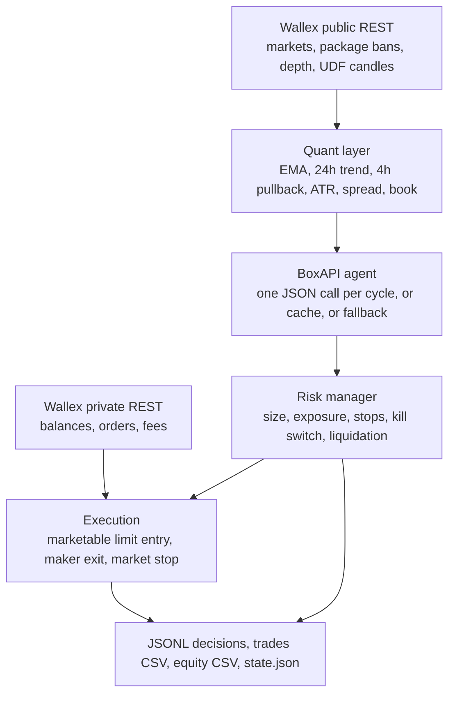

# Strategy

Long-only TMN spot. The bot buys an uptrend that has pulled back, holds about 24 hours, and sells back to TMN. It does not scalp. Round-trip fees on this account are larger than a typical 15-minute move, so the clock is hourly and the stop is wide enough that noise does not tag it.

## Architecture



Backtest, shadow, and live call `evaluate_symbol`, `TradingAgent.decide`, and `RiskManager.plan`. Only the fill model changes.

## Buy

A symbol is a candidate only when every gate passes on the last closed hourly bar:

- EMA(8) > EMA(24) and close > EMA(24).
- 24-hour return ≥ +1%.
- 4-hour return between −2.5% and −0.4% (a pullback, not a crash).
- Hourly ATR ≤ 3% of price.
- Spread ≤ 22 bps. Missing spread blocks the name.
- Top-of-book imbalance is not worse than −0.55 when a book is available.
- Last closed 15-minute return ≥ −0.4% in shadow and live. Backtest passes this as unknown so it does not filter history the 15-minute feed cannot reconstruct honestly.
- Researched gross edge of 0.9% is greater than 1.2 × the round trip the order will pay.

Round trip = taker entry 0.30% + maker time-exit 0.25% + 3 bps slippage = 0.58%. The 0.9% figure is a prior from the last month of hourly majors, not a forecast the model is allowed to inflate.

The quant score is `0.40 × trend + 0.30 × pullback depth + 0.20 × spread + 0.10 × book`. The fallback buys the highest score, one name, size 12% of equity, and writes `DETERMINISTIC_FALLBACK` into the rationale.

## What the model does

One BoxAPI `POST /chat/completions` per decision cycle. Every candidate and open position goes in one compact JSON prompt. The reply is one JSON object: regime, optional `veto_all`, and decisions with action, symbol, size fraction, confidence, and rationale.

The model may:

- rank the candidates and pick at most one BUY,
- cut the size below the quant proposal,
- veto every new entry,
- close a held name only when close is below the slow EMA and the 24-hour return has turned negative.

It may not invent a symbol, raise size, loosen a stop, or override the kill switch. Confidence below 0.55 or a missing rationale is dropped. `temperature` and `response_format` are omitted. `gpt-5-mini` rejects temperature; both flags default to false in `config/default.yaml`.

Budget, because the whole competition is $3:

- at most one network call per cycle, then a cache keyed by the hour and the setup,
- `max_llm_calls_per_hour: 2`, `max_llm_calls_total: 24`, `max_spend_usd: 2.50`,
- assumed prices $0.50 / million input tokens and $2.00 / million output tokens, or $0.08 if the response has no usage,
- token counts and estimated USD are logged on the call and stored on the decision (`agent.usage`) and in `data/llm_usage.json`,
- timeout, HTTP error, bad JSON, a missing key, or a cap all fall back to the deterministic ranking. The source field is `llm`, `llm_cache`, or `fallback`.

Backtest sets `use_llm=False`. A key in the environment cannot spend money during a historical run.

Wallex MCP (`wallex_basic_candle_history`) is an optional note in the prompt. Two failures disable it. The loop does not depend on it. Private user WebSocket needs a cookie JWT, so order status is polled with REST.

## Sell

- Disaster stop at −4.5% from the fill. MARKET when the symbol allows market orders, otherwise an aggressive limit through the bid. Extra 5 bps of slippage is charged in the backtest. A stop starts a 6-hour cooldown on that symbol.
- Trailing stop arms after +2.5% and sells 1.2% off the peak.
- Time exit after 24 hours, as a maker limit at the bid side of the close.
- No fixed take-profit. On this fee tier a tight target converted the 24-hour drift into a loss.
- The model may request an early close under the rule above. The risk layer still checks that a position exists.

## Capital and risk

The risk manager runs after the model and can only shrink a buy.

| Rule | Value |
| --- | --- |
| Per trade and per symbol | 12% of equity |
| Gross exposure | 30% (never all-in) |
| Open positions | 2 |
| New entries per cycle | 1 |
| Entries per hour | 2 |
| Orders per hour | 8 |
| Minimum notional | 50,000 TMN |
| Daily drawdown kill | 1.5% from the Tehran-day start |
| Global drawdown kill | 3% from peak equity |

Either kill switch flattens and blocks new buys until the process is restarted with `--fresh` or the state file is cleared. The flag is persisted in `state.json`.

Universe at startup: config candidates ∩ not on the package-183 ban list ∩ TMN quote ∩ 24h quote volume ≥ 8 billion TMN ∩ spread ≤ 22 bps ∩ at most 6 names. The ban list is fetched from `GET /v1/prop/packages/183`. If that call fails, live and shadow exit. They do not trade a stale allow-list. SOL and BNB sit in the candidate list so the audit shows them, and the spread cap drops them when the book is wide.

## Liquidation

Deadline `2026-10-23T23:50:00+03:30`. Flat-by target `2026-10-23T23:30:00+03:30`.

- Entries stop when fewer than 8 hours remain before flat-by.
- From 22:50 Tehran, phase `passive`: no new buys, resting limits sell inventory.
- From 23:20 Tehran, phase `aggressive`: market sells (or aggressive limits if market orders are disabled). The phase stays aggressive after the deadline until the book is flat.

## Execution assumptions

Entry is a limit at the ask. It is still a LIMIT order, and it pays the taker fee, because a passive bid fill only happens when price keeps falling. The backtest fills that entry at `close × (1 + half spread)`, rounds price up and quantity down to the market's decimals, and charges the taker fee in the base asset. The time exit is modeled at the close minus 3 bps with the maker fee in TMN. Stops use the low of the bar.

Buy fees reduce base quantity. Sell fees reduce TMN proceeds. Equity is mark-to-market in TMN.

## How to evaluate

```bash
python3 -m trader --mode backtest --config config/default.yaml
python3 -m trader --mode report --log-dir results/backtest
```

`results/backtest/report.md` reports net return, max drawdown, annualized Sharpe from the equity spacing, win rate on closed trades, fees, trade count, and how often each agent source spoke. `aggregation_check.json` compares two days of BTCTMN 1-minute bars aggregated locally with the native hourly series. Wallex returns 1-minute bars for resolution `1` and `15`, and 1-hour bars for `60`. The client aggregates anything else itself.

Shadow:

```bash
python3 -m trader --mode shadow --config config/default.yaml --duration 900 --interval 45 --fresh --out results/shadow
```

## Research, and what was not tuned

On roughly 29 days of hourly candles, non-overlapping holds of this setup on the liquid majors were slightly positive after 0.50–0.58% costs: on the order of +0.1% average net trade, equity well under +1% at a 15% weight, max drawdown about 2–3%. Breakouts, continuation, cross-sectional momentum, and tight stops were negative after fees. The shipped parameters are that setup. They were not grid-searched against the backtest equity curve. If the engine backtest is flat, that is the result; names are not dropped after seeing them lose.

The backtest universe uses a spread snapshot from 2026-10-22 when no live book is passed in. That is lookahead of *which names are liquid*, not of future prices. Shadow and live replace the snapshot with the current book.

## Wallex details that are still uncertain

Check these before sending real orders:

- Whether `sub-account-client-id` is required when the key already belongs to the credit sub-account. The header is sent only if `WALLEX_SUBACCOUNT_ID` is set.
- The live fee tier from `GET /v1/account/fee`. Defaults are 0.25% maker / 0.30% taker. Live replaces them per symbol when the key works.
- Whether `unavailableMarkets` changes after the plan is activated. The bot refetches it and refuses every symbol on the list. USDTTMN and BTCTMN were tradable in the 2026-10-22 fetch; ZECTMN was not. Do not trust an empty list from an older video.
- MARKET quantity is sent as base-asset size. Confirm that on a tiny order if you use a market stop.
- Some symbols report `isMarketTypeEnable: false` (DOGE and XRP did in one snapshot). Stops then become aggressive limits.
- Order rate limit is treated as 15 per 10 seconds inside the documented 20 per 10 seconds. Public reads are paced at 5 per second.
- `minNotional` on the allowed TMN markets was 50,000 TMN. The client rejects a body under the live rule.
- `tickSize` and `stepSize` are decimal counts, not increments. Prices and quantities are formatted as fixed-point strings. POST `/v1/account/orders` expects HTTP 201.
- Half-spread entry is an assumption about queue position. A real limit at the ask can still miss if the book steps away.
- No private WebSocket. Fills are observed by GET `/v1/account/orders/{clientOrderId}`.

## خلاصه فارسی

ربات فقط روی جفت‌های تومانی مجاز پلن ۱۸۳ معامله می‌کند و فهرست بازارهای ممنوع را در شروع می‌گیرد. سیگنال، پولبک در روند صعودی ساعتی است و فقط وقتی فعال می‌شود که هزینه رفت‌وبرگشت کارمزد را پوشش بدهد. مدل زبانی حداکثر یک بار در هر چرخه همه نمادها را با هم رتبه‌بندی یا رد می‌کند و اگر سقف هزینه یا خطا پیش بیاید، لایه قطعی جایگزین می‌شود. حد ضرر، سقف حجم، و خروج اجباری قبل از ۲۳:۳۰ روز ۲۳ اکتبر ۲۰۲۶ به وقت تهران خارج از اختیار مدل هستند.
