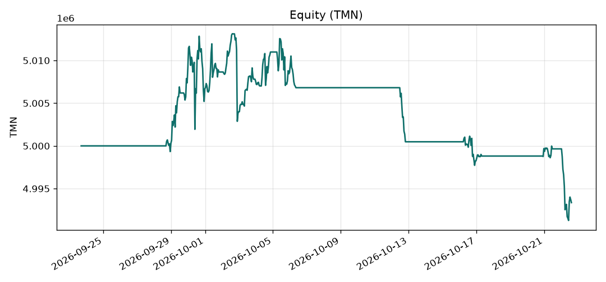
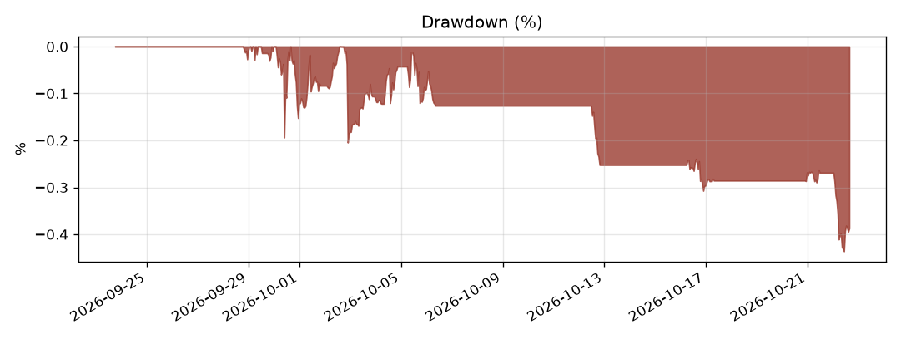

# Wallex backtest

## Desk metrics

| Metric | Value |
| --- | --- |
| PnL after fees (mark-to-market) | -6,976 TMN (-0.140%) |
| PnL after fees (realized) | -1,038 TMN |
| Sharpe (annualized from the equity spacing) | -1.47 |
| Max drawdown | 0.415% |
| Hit rate | 58.8% (17 closed trades) |
| Decision latency | n/a |

| Other | Value |
| --- | --- |
| Starting equity | 5,000,000 TMN |
| Ending equity | 4,993,024 TMN |
| Average closed-trade PnL | -61 TMN |
| Fees paid | 10,242 TMN |
| Fills | 36 |
| Decision cycles | 731 |
| Agent sources | fallback=695 |
| Logged errors | 0 |

Equity samples: 695.

The return is mark-to-market in toman, including fees. Hit rate counts a closed trade as a win when its realized toman PnL is positive. Sharpe uses the median spacing of the equity samples, so an hourly backtest and a short shadow run are not on the same scale. Latency is the decision cycle, from the book fetch through the risk plan.

## Walk-forward and deflated Sharpe

Full sample: per-bar Sharpe -0.0157, selection hurdle 0.0484 at N=6, deflated Sharpe probability 0.0427.

| Fold | Return | Realized PnL | Fees | Fold DSR |
| --- | --- | --- | --- | --- |
| 1 | 0.102% | 5095.37 | 7911.08 | 0.1632 |
| 2 | -0.139% | -6927.25 | 1146.45 | 0.0001 |
| 3 | -0.145% | -7234.37 | 2406.94 | 0.0033 |

Folds use the same frozen parameters and a fresh 5,000,000 TMN. The deflated Sharpe probability is Bailey and López de Prado (2014): the chance the observed per-bar Sharpe beats the expected maximum of N null trials, after skew and kurtosis. It is not an annualized Sharpe.

## Random-entry baseline

1000 seeded runs. Entries are random times on the same universe, with the denylist, 24-hour hold, stop, trail, fees, and size cap left as configured. Each run attempts 17 entries.

Strategy return -0.14% is at the 76.7 percentile of the random-entry returns. Strategy Sharpe -1.47 is at the 61.4 percentile.

|  | p05 | p25 | p50 | p75 | p95 |
| --- | ---: | ---: | ---: | ---: | ---: |
| return % | -2.389 | -1.418 | -0.777 | -0.184 | 0.598 |
| Sharpe | -6.49 | -4.04 | -2.30 | -0.55 | 1.94 |
