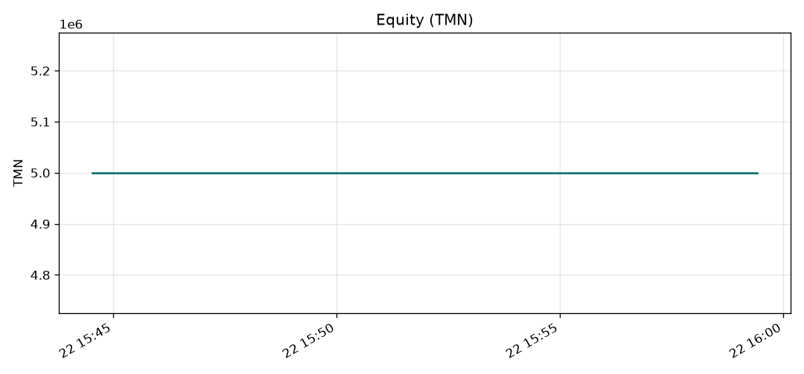
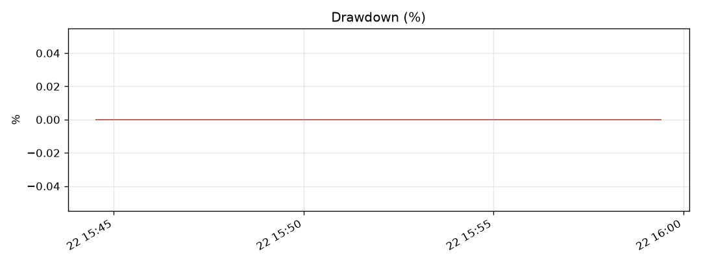

# Wallex shadow report

| Metric | Value |
| --- | --- |
| Starting equity | 5,000,000 TMN |
| Ending equity | 5,000,000 TMN |
| Net return | 0.000% |
| Max drawdown | 0.000% |
| Sharpe (annualized from the equity spacing) | 0.00 |
| Round trips | 0 |
| Win rate | 0.0% |
| Average closed-trade PnL | 0 TMN |
| Fees paid | 0 TMN |
| Fills | 0 |
| Decision cycles | 21 |
| Agent sources | fallback=19 |
| Logged errors | 0 |

Equity samples: 19.

The return is mark-to-market in toman, including fees. A closed trade wins when its realized toman PnL is positive. Sharpe uses the median spacing of the equity samples, so an hourly backtest and a 45-second shadow run are not on the same scale.
